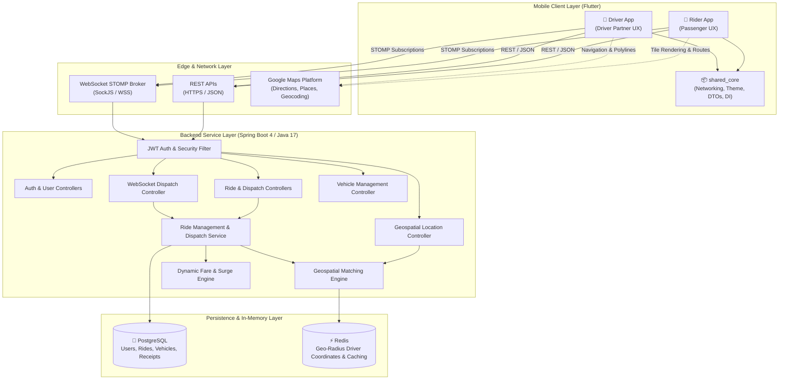
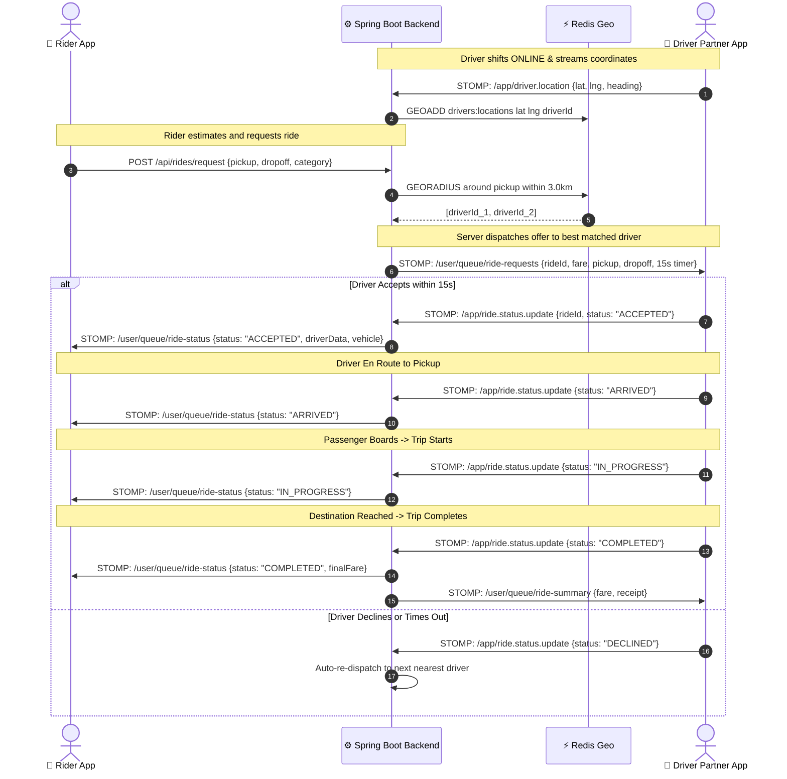
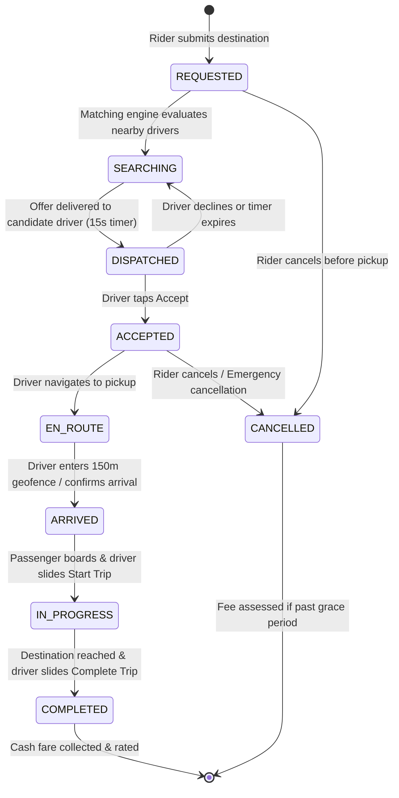
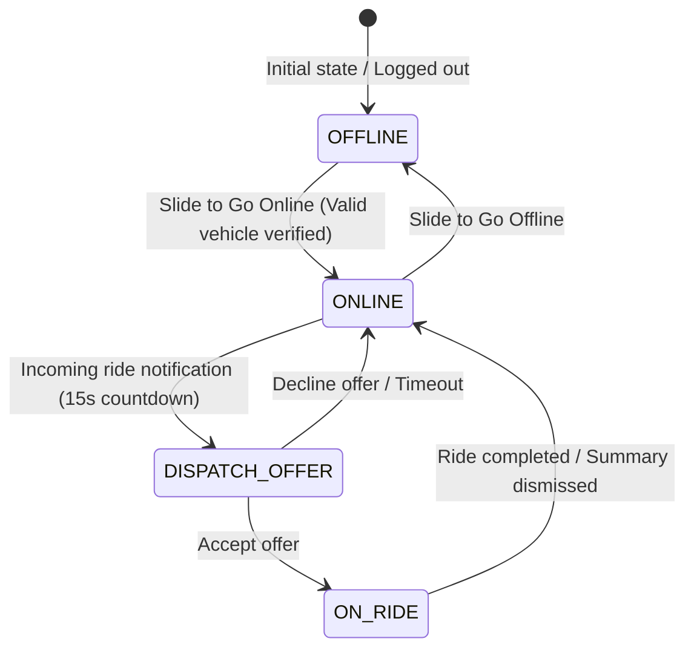

# RideNest Platform — Architecture & System Structure

Comprehensive technical blueprint of the RideNest ride-sharing ecosystem, detailing system topology, repository layout, layered design patterns, real-time messaging protocols, and state machines.

---

## 1. System Topology & Architecture

RideNest operates as a distributed system with a centralized Spring Boot backend, Redis geospatial indexing, PostgreSQL persistence, and two Flutter mobile clients (Rider App and Driver App) powered by a unified `shared_core` library.



---

## 2. Workspace Monorepo Layout

The workspace is organized into four distinct modules:

```
ride-share-workspace/
├── ride-share/              # Spring Boot 4 Backend Service (Java 17, Maven)
├── rider_app/               # Flutter Mobile Client for Passengers
├── driver_app/              # Flutter Mobile Client for Driver Partners
├── shared_core/             # Shared Dart Package (Networking, Storage, Design System)
├── screenshots/             # Production Screen Captures & Visual Documentation
│   ├── rider_app/           # Complete Rider UI Flow (00-11)
│   └── driver_app/          # Complete Driver UI Flow (00-12)
├── README.md                # Project Overview & Visual Showcase
└── structure.md             # Architecture & Technical Reference (This Document)
```

---

## 3. Module Breakdown

### 3.1. Backend Service (`ride-share/`)

The backend follows the Spring Boot Layered Clean Architecture pattern with explicit boundary separation between HTTP handling, business logic, persistence, and messaging.

```
ride-share/src/main/java/com/rajkumartimalsina/rideShare/
├── config/                  # App configurations: Web, Security, WebSocket, Redis, Swagger
│   ├── RedisConfig.java
│   ├── SecurityConfig.java
│   └── WebSocketConfig.java
├── controllers/             # REST & STOMP Endpoints
│   ├── AuthController.java           # POST /api/auth/register, /api/auth/login
│   ├── UserController.java           # GET/PUT /api/users/profile
│   ├── VehicleController.java        # CRUD /api/vehicles
│   ├── LocationController.java       # POST /api/location/driver/update
│   ├── RideController.java           # POST /api/rides/estimate, /request, /cancel
│   └── RideWebSocketController.java  # STOMP /app/ride.status.update, /app/driver.location
├── services/                # Business logic contracts
│   ├── AuthService.java
│   ├── UserService.java
│   ├── VehicleService.java
│   ├── LocationService.java
│   ├── RideService.java
│   └── impl/                         # Concrete service implementations
├── repositories/            # Spring Data JPA interfaces
│   ├── UserRepository.java
│   ├── VehicleRepository.java
│   ├── RideRepository.java
│   └── DriverLocationRepository.java
├── entities/                # Relational JPA entities
│   ├── User.java                     # Rider & Driver identities
│   ├── Vehicle.java                  # Registered vehicles (Make, Model, Plate, Category)
│   ├── Ride.java                     # Trips, locations, fares, status transitions
│   └── Enums.java                    # RideStatus, Role, VehicleType, PaymentType
├── dto/                     # Strongly typed Request / Response DTOs
│   ├── auth/
│   ├── ride/
│   ├── vehicle/
│   └── location/
├── security/                # JWT Token provider, AuthFilter, UserDetails implementation
│   ├── JwtTokenProvider.java
│   └── JwtAuthenticationFilter.java
└── exception/               # Global exception handlers & custom domain exceptions
    ├── GlobalExceptionHandler.java
    └── ResourceNotFoundException.java
```

---

### 3.2. Shared Core Library (`shared_core/`)

A reusable, shared package consumed by both mobile clients to guarantee zero code duplication, unified themes, shared domain DTOs, and consistent network handling.

```
shared_core/lib/
├── core/
│   ├── di/                  # Service Locator setup (get_it)
│   ├── network/             # Dio client, PrettyDioLogger, AuthInterceptors
│   ├── storage/             # SecureStorage, SharedPreferences, Hive local persistence
│   ├── theme/               # Colors, typography, input decorations, button styles
│   └── utils/               # MapUtils, DistanceUtils, DateTimeFormatters
├── data/
│   ├── remote/              # StompClientWrapper, BaseApiService
│   └── models/              # UserDto, VehicleDto, RideDto, CoordinatesDto
└── ui/
    ├── widgets/             # CustomMapView, SlideToActButton, AppAlerts
    └── common/              # SkeletonLoader, LoadingOverlay, StatusPill
```

---

### 3.3. Rider Mobile App (`rider_app/`)

Built using Flutter with BLoC / Cubit state management following a feature-first structure.

```
rider_app/lib/
├── src/
│   ├── core/
│   │   ├── di/              # Rider app dependency injection
│   │   └── routing/         # GoRouter definitions (/, /login, /home, /history, /profile)
│   ├── data/
│   │   ├── local/           # AuthLocalDataSource, LocationCacheDataSource
│   │   ├── remote/          # RiderApiService, RiderStompService
│   │   └── repo/            # RiderRideRepository, UserRepository
│   └── modules/
│       ├── auth/            # Login, Registration, Splash Screens & Cubits
│       ├── home/            # Map Dashboard, Location Picker, Where-to Search
│       │   ├── blocs/       # RiderHomeCubit, LocationSearchCubit
│       │   ├── views/       # HomeScreen, MapAddressPickerModal
│       │   └── widgets/     # AddressSearchBar, LocationPill, RecentsList
│       ├── ride/            # Ride Selection, Fare Estimate, Radar Search
│       │   ├── blocs/       # RideBookingCubit, RideTrackingCubit
│       │   ├── views/       # RideOptionSheet, DriverFoundSheet, ActiveRideHUD
│       │   └── widgets/     # VehicleCategorySelector, RadarPulseWidget
│       ├── ride_history/    # My Rides & Trips
│       │   ├── blocs/       # RiderRideHistoryCubit
│       │   └── views/       # RideHistoryScreen, TripReceiptModal
│       └── profile/         # Rider Profile & Account Settings
│           ├── blocs/       # RiderProfileCubit
│           └── views/       # ProfileScreen
└── main.dart
```

---

### 3.4. Driver Partner App (`driver_app/`)

Engineered for reliability, real-time dispatch alerts, proximity geofencing, and shift management.

```
driver_app/lib/
├── src/
│   ├── core/
│   │   ├── di/              # Driver app dependency injection
│   │   └── routing/         # GoRouter definitions (/, /login, /home, /history, /profile, /vehicles)
│   ├── data/
│   │   ├── local/           # DriverAuthLocalDataSource
│   │   ├── remote/          # DriverRideApiService, DriverStompService
│   │   └── repo/            # DriverRideRepo, VehicleRepo
│   └── modules/
│       ├── auth/            # Partner Portal Login & Registration
│       ├── home/            # Driver Dashboard, Shift Toggle, GPS Tracking
│       │   ├── blocs/       # DriverStatusCubit
│       │   ├── views/       # HomeScreen
│       │   └── widgets/     # DriverStatusTopBar, DriverVehicleCard, CustomPuckMarker
│       ├── ride/            # Incoming Dispatch Modal & Alerts
│       │   ├── blocs/       # RideDispatchCubit
│       │   ├── utils/       # RideNotificationAlertService (Audio & Vibration)
│       │   ├── views/       # RideRequestSheet, RideRequestMapMarkers
│       ├── trip/            # Active Trip Lifecycle & Completion
│       │   ├── utils/       # TripLocationUtils (Haversine distance, ETA calculation)
│       │   ├── views/       # ActiveTripPanel, TripSummarySheet
│       │   └── widgets/     # SlideToActButton, ProximityIndicator
│       ├── vehicle/         # Fleet & Vehicle Management
│       │   ├── blocs/       # VehicleCubit
│       │   └── views/       # MyVehiclesScreen, VehicleRegisterScreen
│       └── ride_history/    # Partner Shift History & Fares
│           ├── blocs/       # DriverRideHistoryCubit
│           └── views/       # RideHistoryScreen
└── main.dart
```

---

## 4. Real-Time Dispatch Protocol & Messaging Flow

Real-time interactions between Rider, Driver, and Server utilize WebSockets over STOMP with SockJS fallback.



---

## 5. State Machines

### 5.1. Ride Lifecycle State Machine



### 5.2. Driver Shift State Machine



---

## 6. Proximity Geofencing & Safety Guards

1. **150-Meter Urban Geofence**:
   - The driver cannot trigger `ARRIVED` until GPS coordinates place them within 150 meters of the scheduled pickup coordinate.
   - Built-in manual override dialog allows arrival confirmation only after clear driver intent to handle urban concrete canyon GPS drift.
2. **Server-Authoritative Fare Enforcement**:
   - Fares and surges are authoritatively computed on the server. Clients cannot alter fare metrics or inject discount payloads.
3. **Data Protection & Location Privacy**:
   - Ephemeral driver locations in Redis expire after 30 seconds of inactivity.
   - Exact client coordinates are never exposed via unauthenticated endpoints.

